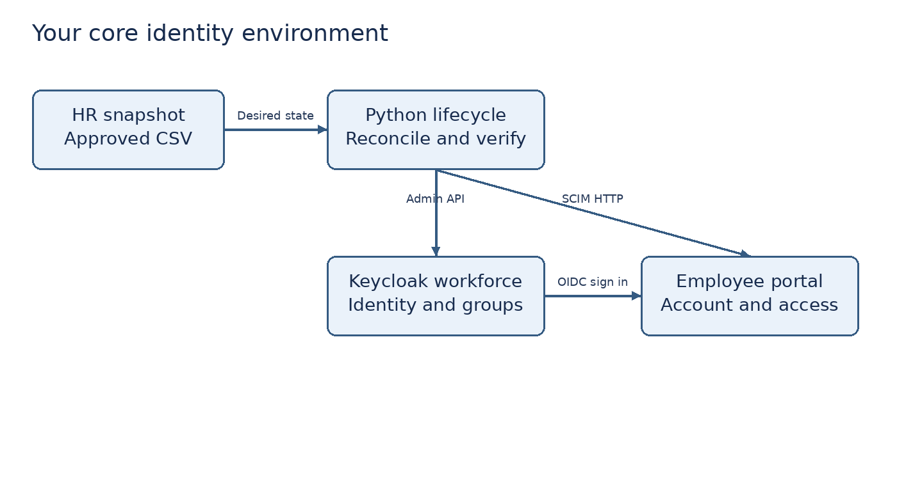

# Step 2 Prepare Windows and understand the architecture

**Practical status: NOT STARTED.**


**Terms:** a container packages an application and its dependencies. A realm is an isolated identity namespace in Keycloak. Loopback means your own computer; `localhost` and `127.0.0.1` refer to it. A redirect URI is the exact address the IdP is allowed to send your browser back to after authentication. A bearer token gives access to whoever possesses it.

1. Close the existing VirtualBox lab VMs while using this project, especially if your computer has 16 GB RAM. This project does not need DC01 running.
2. Download Docker Desktop for Windows from the official Docker site [R1]. Select its WSL 2/Linux container setup. If requested, run `wsl --install` from Administrator PowerShell, restart Windows, and finish Docker setup. Only use Administrator PowerShell when Windows installation requires it.
3. Start Docker Desktop and wait for the engine to report that it is running. Run `docker version` in a normal PowerShell terminal. You should see client and server information. If only the client appears, the engine is not ready.
4. Install Python 3.12 or 3.13 from `https://www.python.org/downloads/windows/`. Enable the Python launcher during installation. Run `py --version`. A Microsoft Store prompt usually means Python or its path/launcher needs attention.
5. Install VS Code and Git if needed. Extract the ZIP into a folder such as `C:\Projects\Northstar-IAM`. Open the contained `iam-lab` folder with VS Code using File → Open Folder.
6. Open Terminal → New Terminal. Confirm your working folder ends in `iam-lab`. Run the following:

```powershell
py -m venv .venv
.\.venv\Scripts\python.exe -m pip install -r requirements.txt
New-Item -ItemType Directory -Force private
```

There is no need to activate the environment; the explicit Python path avoids PowerShell execution policy changes. `private` will hold local state, reports and logs that should not be committed automatically.

**Architecture:** HR snapshot → lifecycle script → Keycloak Admin API and SCIM HTTP API. The browser signs into Keycloak using OIDC and returns to the portal. The portal checks the provisioned account, department membership and temporary grants at each protected request. SSO alone does not create a portal account.



**Boundary:** Keycloak runs at `http://localhost:8080`; the portal runs at `http://localhost:5000`. The local HTTP exception is for an isolated development lab. Corporate deployments require HTTPS, trusted certificates, restricted management access, hardened application hosting, managed secrets and durable audit storage. Never expose these development services publicly.

**Evidence:** sanitized tool versions and architecture explanation. **Checkpoint:** explain why Okta hosted in the cloud cannot directly send SCIM requests to a service listening only on your laptop's localhost.
