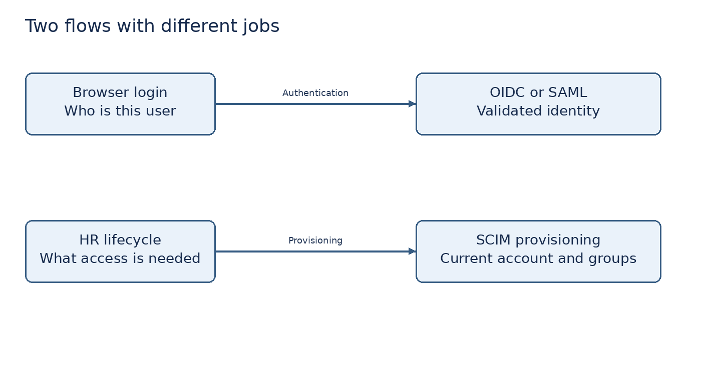

# Step 4 Configure OIDC and start the employee portal

**Practical status: NOT STARTED.**


**What we are doing:** integrate a real relying application with the IdP. OIDC adds identity information to OAuth 2.0. OAuth itself is an authorization framework; it is not interchangeable with authentication.

**Terms:** a client is an application registered with the IdP. An authorization code is exchanged for tokens through the application's back channel. PKCE binds that exchange to the client that began the request. `state` helps protect the login redirect flow; `nonce` binds an ID token to the authentication request. An ID token is for the client to verify authentication; an access token is for an API to authorize access. Do not use an ID token as a generic API bearer credential.

1. In workforce → Clients → Create client, select OpenID Connect. Client ID: `employee-portal`. Name: Employee portal. Next.
2. Enable Client authentication and Standard flow. Disable Direct access grants and Implicit flow. Save.
3. In Access settings set Valid redirect URIs to exactly `http://localhost:5000/callback`. Set Home URL to `http://localhost:5000/`. Do not use a wildcard redirect. Save.
4. Open Advanced settings and set Proof Key for Code Exchange Code Challenge Method to S256 if that setting is exposed. The supplied client sends S256 PKCE. Keep the standard `profile` and `email` client scopes available.
5. Open Credentials. Copy the client secret privately. Do not commit it or place it in an evidence screenshot.
6. Before starting Terminal A, generate a SCIM token with `.\.venv\Scripts\python.exe -c "import secrets; print(secrets.token_urlsafe(32))"`. Save it privately in a password manager. Then create Terminal A in VS Code, in `iam-lab`, and set the values below. Use fresh random secrets each time you rebuild the lab:

```powershell
$env:PORTAL_SECRET = .\.venv\Scripts\python.exe -c "import secrets; print(secrets.token_urlsafe(32))"
$env:SCIM_TOKEN = Read-Host 'Paste a random SCIM token generated and saved privately'
$env:OIDC_CLIENT_SECRET = Read-Host 'Paste the employee portal client secret'
$env:OIDC_CLIENT_ID = 'employee-portal'
$env:OIDC_DISCOVERY = 'http://localhost:8080/realms/workforce/.well-known/openid-configuration'
$env:AUTHLIB_INSECURE_TRANSPORT = '1'
.\.venv\Scripts\python.exe app\portal.py
```

7. Store the generated SCIM token in a password manager before launching the last command, or set it using a value generated and saved privately beforehand. Terminal B must use the same SCIM token. Do not rotate it between the two terminals accidentally. Environment variables are terminal-specific; they are not a vault.
8. Open `http://localhost:5000`. You should see Employee portal and Sign in with SSO. The employee accounts do not exist yet; finish Step 6 before the first successful employee login.
9. Keep Terminal A running. Its local development server is intentional for the lab, with debug mode off and loopback binding. Do not ignore this hosting limitation in your README.

**Under the hood:** Authlib uses discovery metadata and verifies the token as part of the code flow. The portal stores only selected identity claims in its signed session cookie, not raw tokens. It imposes a five-minute local session age. Its local logout clears the application session, not the Keycloak session. HTTP cookies are not Secure in this loopback development configuration; production requires HTTPS and Secure cookies.



**Evidence:** client settings with secret hidden and the portal home screen. **Checkpoint:** why does a successful SSO callback still return 403 when a target account has not been provisioned?
